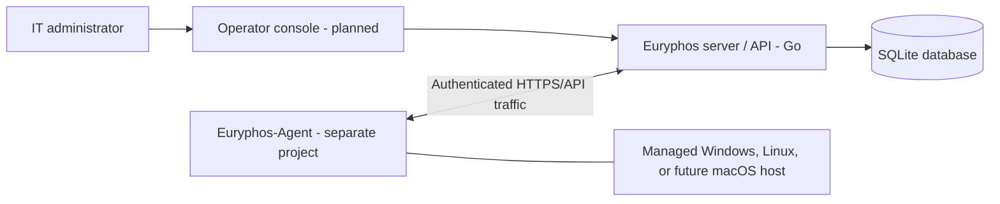

# Euryphos

**Centralized fleet visibility and endpoint management, built in Go.**

Euryphos is an enterprise systems-management platform in early development. This repository contains the **central management server**, HTTP API, SQLite persistence layer, schema migrations, and server deployment configuration. It is intended to run once in a central environment and manage separately installed endpoint agents.

> [!WARNING]
> **Development status: early development — not production-ready.** This repository is an architectural and API foundation, not a complete endpoint-management product. Do not rely on it for production patching, configuration enforcement, or security-critical fleet operations.

## What Euryphos is being built to do

- **Fleet visibility:** continuously collect hardware, operating-system, installed-application, service, security, and configuration inventory.
- **Fleet search:** find managed devices, installed software, and configuration state across an environment.
- **Controlled operations:** target one endpoint, a selected group, or a larger fleet with authenticated and auditable jobs.
- **Patch orchestration:** discover and coordinate operating-system and approved third-party software updates.
- **Configuration management:** apply desired settings, detect drift, and verify remediation.
- **Operational evidence:** track endpoint check-ins, job outcomes, failures, pending restarts, and compliance.

These are product goals. Only the subset described under [Current implementation](#current-implementation) exists in the code today.

## Two-repository architecture

Euryphos is distributed as two independent projects:

| Repository | Responsibility |
|---|---|
| **[Euryphos](https://github.com/gitarman94/Euryphos)** (this repository) | Central Go server, HTTP API, SQLite database, migrations, server configuration, and server deployment |
| **[Euryphos-Agent](https://github.com/gitarman94/Euryphos-Agent)** | Separately installed Go endpoint agent, OS inventory providers, endpoint service integration, and Linux/Windows/macOS client installers as they are implemented |

Install the server once on a central host. Install only **Euryphos-Agent** on each managed workstation or server. The agent initiates outbound authenticated requests to the server; it does not require a local copy of the server or its SQLite database.

The previous `CommandPilot-Agent` repository is the historical client project. Its old identity, API compatibility, and installer scripts must be audited and migrated before they can be treated as supported Euryphos installation paths. The current standalone agent deliverable is maintained separately from this server repository.

## Architecture



The server uses embedded SQLite. No separate PostgreSQL or database server is required. WAL journaling allows concurrent readers, while SQLite still serializes writers. This is a single-server/single-host design; multi-node database clustering is not part of the current implementation.

## Current implementation

This repository currently includes:

- Go HTTP server using the standard library.
- SQLite storage through the pure-Go `modernc.org/sqlite` driver.
- Startup schema creation/migration path and an initial SQL migration reference.
- Endpoint enrollment using a shared enrollment secret and per-device bearer credentials.
- Administrator approval and revocation endpoints.
- Device authentication, heartbeat, and categorized inventory ingestion.
- Administrator device listing, job creation, and job status retrieval.
- Agent job polling and result reporting endpoints.
- Docker Compose deployment with a persistent SQLite volume.

### Not implemented or not production-ready

- **No browser web UI is implemented yet:** dashboard, Devices-list, and device-detail pages, frontend templates/assets, and browser login/session workflow remain outstanding.
- Initial administrator APIs now provide `GET /api/v1/devices/{id}` for current device identity/latest inventory and `GET /api/v1/devices/{id}/inventory/history` for bounded, cursor-paginated inventory snapshots. The Devices-list API also supports basic search, status/OS filters, allowlisted sorting, and bounded pagination. Full field coverage, activity types, fleet-wide trend aggregation, and the browser UI remain incomplete.
- Full hardware, service, security, and configuration inventory providers.
- Functional patch installation, software deployment/removal, configuration enforcement, and most privileged job executors.
- Production server installers, signed release artifacts, and tested upgrade/backup/restore procedures.
- A tested one-command Debian 13 / Proxmox LXC deployment.
- Certified support for any Linux distribution or Windows release; see the [support matrix](docs/SUPPORT_MATRIX.md).
- End-to-end verification of this server against the separately distributed Euryphos-Agent binary.
- Enterprise SSO/MFA/RBAC, multi-tenancy, comprehensive audit controls, and production-hardened agent communications.
- Fleet-scale throughput testing, data retention, backup/restore drills, and disaster recovery guarantees.

A route or placeholder is not evidence that an end-user capability is complete. Review [implementation status](docs/IMPLEMENTATION_STATUS.md) and the [completion plan](docs/COMPLETION_PLAN.md).

## Platform direction

The product roadmap includes:

- **Arch family:** Arch Linux and CachyOS, with EndeavourOS and Manjaro as additional candidates.
- **Debian family:** Debian, Ubuntu LTS, Linux Mint (Ubuntu-based editions), and Linux Mint Debian Edition (LMDE).
- **Fedora family:** Fedora Workstation/Server and Nobara.
- **Image-based Linux:** Bazzite and other Fedora Atomic variants through image-aware update providers.
- **Windows:** workstation and server editions, with supported versions/builds to be defined.
- **macOS:** a future Euryphos-Agent implementation for Intel and Apple Silicon.

These are **planned targets, not certified compatibility claims**. Installation, inventory, patching, upgrades, rollback, and server communication must be tested separately for every target before support is claimed.

## Getting started — development build

**Requirements:** Go 1.23 or later. The server embeds SQLite; a separate database service is not required.

Clone this server repository:

```bash
git clone https://github.com/gitarman94/Euryphos.git
cd Euryphos
```

Download dependencies and run tests:

```bash
go mod download
go test ./...
go vet ./...
```

Set independent high-entropy administrator and enrollment secrets, then start the development server:

```bash
export EURYPHOS_ADMIN_TOKEN="$(openssl rand -hex 32)"
export EURYPHOS_ENROLLMENT_TOKEN="$(openssl rand -hex 32)"
export EURYPHOS_DB_PATH="./data/euryphos.db"
export EURYPHOS_LISTEN=":8080"
go run ./cmd/euryphos-server
```

Check server health:

```bash
curl --fail http://127.0.0.1:8080/api/health
```

This is a development startup procedure, not a production deployment recipe. Do not expose the development listener directly to the Internet. Production deployment needs TLS, secret management, restrictive network access, service hardening, safe database backups, and tested upgrade/recovery procedures.

### Docker Compose

Create `.env` from the example, replace both placeholder values with unique random secrets, and start the server:

```bash
cp .env.example .env
# Edit .env and set unique EURYPHOS_ADMIN_TOKEN and EURYPHOS_ENROLLMENT_TOKEN values.
docker compose up -d --build
```

The database is stored in the `euryphos-data` named volume mounted at `/var/lib/euryphos`. Back up this persistent data using SQLite's online backup API or a tested quiesced backup procedure. Do not assume that copying only the `.db` file during active WAL writes is sufficient.

## Configuration

| Variable | Purpose | Default |
|---|---|---|
| `EURYPHOS_LISTEN` | HTTP listen address | `:8080` |
| `EURYPHOS_DB_PATH` | SQLite database file | `./data/euryphos.db` |
| `EURYPHOS_ADMIN_TOKEN` | Administrator API bearer secret | Required |
| `EURYPHOS_ENROLLMENT_TOKEN` | Endpoint enrollment bearer secret | Required |
| `EURYPHOS_AUTO_MIGRATE` | Apply initial schema on startup | `true` |

Never reuse development secrets in production. Do not expose an unencrypted HTTP listener to untrusted networks; terminate TLS at a trusted reverse proxy or configure a hardened TLS deployment before production use.

## Current API surface

| Method | Endpoint | Purpose |
|---|---|---|
| `GET` | `/api/health` | Health check |
| `POST` | `/api/v1/enrollment` | Request endpoint enrollment |
| `POST` | `/api/v1/devices/{id}/approve` | Approve a pending endpoint (administrator) |
| `POST` | `/api/v1/devices/{id}/revoke` | Revoke an endpoint (administrator) |
| `POST` | `/api/v1/devices/{id}/heartbeat` | Endpoint heartbeat (device credential) |
| `POST` | `/api/v1/devices/{id}/inventory` | Submit inventory category (device credential) |
| `GET` | `/api/v1/devices` | List endpoints (administrator) |
| `POST` | `/api/v1/jobs` | Create a job for approved endpoints (administrator) |
| `GET` | `/api/v1/devices/{id}/jobs/next` | Claim next queued endpoint job (device credential) |
| `POST` | `/api/v1/devices/{id}/jobs/{job}/result` | Report job result (device credential) |
| `GET` | `/api/v1/jobs/{id}` | Retrieve job status (administrator) |

The API is an early implementation contract and may change before a stable release. Administrative requests require the configured administrator bearer token; endpoint requests require an approved device token. See [Go architecture](docs/GO_ARCHITECTURE.md).

## Security and operational notes

- Configure unique, high-entropy administrator and enrollment secrets; never use example values in production.
- Put the service behind TLS and restrict access to administrative endpoints.
- Keep the SQLite database and configuration files restricted to the server service account.
- Use SQLite's online backup facility or a tested quiesced procedure; include WAL behavior in backup/restore testing.
- Do not enable arbitrary shell execution as a remote action. Job executors must be typed, narrowly allowlisted, authorized, and auditable.
- Review implementation status and complete the threat model before production deployment.

## Documentation

- [`docs/PRODUCT_OVERVIEW.md`](docs/PRODUCT_OVERVIEW.md) — product goals and requirements.
- [`docs/DEVICE_MANAGEMENT_UI_SPEC.md`](docs/DEVICE_MANAGEMENT_UI_SPEC.md) — Devices table, complete device details, telemetry fields, API/storage design, and privacy acceptance criteria.
- [`docs/GO_ARCHITECTURE.md`](docs/GO_ARCHITECTURE.md) — server/API and SQLite architecture.
- [`docs/REPOSITORY_LAYOUT.md`](docs/REPOSITORY_LAYOUT.md) — server and independently distributed agent responsibilities.
- [`docs/SUPPORT_MATRIX.md`](docs/SUPPORT_MATRIX.md) — planned platform and distribution support.
- [`docs/INSTALLER_STATUS.md`](docs/INSTALLER_STATUS.md) — server installation and deployment readiness.
- [`docs/IMPLEMENTATION_STATUS.md`](docs/IMPLEMENTATION_STATUS.md) — implemented code and verified limitations.
- [`docs/COMPLETION_PLAN.md`](docs/COMPLETION_PLAN.md) — engineering roadmap and release acceptance checklist.
- [`docs/BRAND_IDENTITY.md`](docs/BRAND_IDENTITY.md) — product name and pronunciation.

## License and commercial use

Euryphos is source-available under the **Euryphos Personal Use License (EPUL) 1.0**. Individuals may use and modify it free of charge for their own personal devices, home lab, hobby, and self-directed learning. Use by or on behalf of a company, corporation, or other business—including managing its devices or infrastructure—requires a separate written commercial license. Other institutional situations are addressed in [`LICENSE`](LICENSE).

This is **not an OSI-approved open-source license**. Read [`LICENSE`](LICENSE) and [`COMMERCIAL-LICENSING.md`](COMMERCIAL-LICENSING.md) before use. Third-party components and previously granted rights remain subject to their applicable licenses; this license does not withdraw rights already granted under another license.
